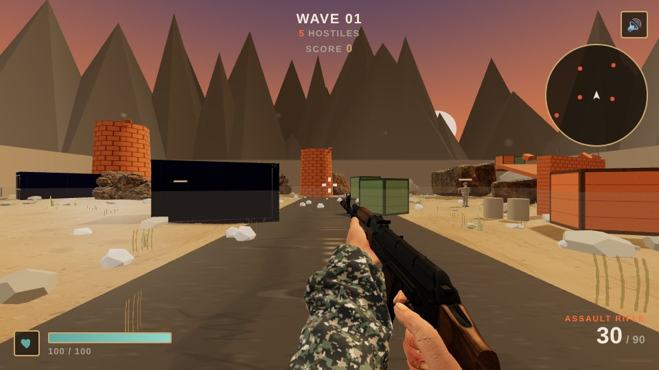

# BULLETFALL — Test Arena

A browser-based first-person shooter built with [Three.js](https://threejs.org/) r128, plain JavaScript and CSS. No build step, no bundler, no framework. **[Play it](https://alakh-best.github.io/BulletFall/)**



## Features

- **Waves of enemy bots**, including elites, with a score, streaks, XP and levels that unlock weapons.
- **Six weapons:** assault rifle, SMG, shotgun, sniper, LMG and a combat knife. The LMG is deployed rather than carried: equipping it locks movement and tightens spread.
- **Two maps:** Dustline Canyon (default) and Abandoned Street, a real modeled city street with collision built from its actual geometry.
- **Pickups:** killed bots can drop ammo crates and medikits that despawn after about 22 seconds.
- **HUD:** minimap, kill feed, floating damage numbers and an accuracy stat.
- **Desktop and mobile controls**, weather effects and synthesized sound.

## Running it

The game fetches its models at runtime, so it has to be served over HTTP. Opening `index.html` from disk will not work.

```bash
python3 -m http.server 8080
```

Then open `http://localhost:8080`. GitHub Pages serves it with no setup (Settings → Pages → Deploy from branch → `main` / root).

## Project structure

```
index.html           page shell: markup only
css/style.css        all styling (HUD, menus, overlays)
js/error-handler.js  top-level error banner
js/gltf-loader.js    GLTFLoader adapted for r128's non-module build
js/game/             the game, split into ordered scripts that share one global scope
                     (load order is set in index.html; files are numbered 01-18)
assets/              .glb models, fetched at runtime
```

The scripts under `js/game/` are: config, audio, scene, arena, theme application, collision, input, player, weapon models, weather, pickups, HUD feed, weapons, bots, waves and score, HUD, game state, and the main loop.

## Notes

- **Performance:** the Abandoned Street model is about 13 MB, so it loads only the first time someone picks that map. Real models are brought in one at a time because loading several large ones together once exhausted GPU memory on real hardware. The concrete barrier and sandbag wall props are still disabled for that reason.
- **Procedural weapons:** the sniper, SMG and knife are built from basic shapes. The AK47 is a rigged model with animations; the shotgun and LMG are static meshes held by the shared procedural arms.
- **Street model licence:** the source and licence of `assets/abandoned_city_street.glb` ("Abandoned City Street For Games") are unknown, and it is included at the repo owner's instruction. Every other asset is CC0 or CC-BY. If its origin matters for your use, swap in a model with a clear licence.

## Credits

- "Ak47" first-person rigged model by kursat_sokmen (https://skfb.ly/6UEL9), licensed CC BY 4.0.
- "Low-Poly Browning M2E2" by Kaan (https://skfb.ly/ovSrR), licensed CC Attribution 4.0 (http://creativecommons.org/licenses/by/4.0/).
- "870 MCS Shotgun" by FelipeMSX (https://sketchfab.com/3d-models/870-mcs-shotgun-8fa7d482920e4eda8648766fb38596c0), licensed CC Attribution.
- "Shipping Container" by chaschinkaa (https://sketchfab.com/3d-models/shipping-container-7bf5a49425134544b9b6708c4e45ce11), licensed CC Attribution 4.0.
- "Lowpoly Concrete Barrier" by qb (https://sketchfab.com/3d-models/lowpoly-concrete-barrier-e0fb4ba5ee434433bbdb4a16aaa2f8fb), licensed CC Attribution 4.0.
- "Sandbag Wall 04" by Pypunk (https://sketchfab.com/3d-models/sandbag-wall-04-a5ea125e9d534b54a3185f349da6aabd), licensed CC Attribution 4.0.
- "Boulder 01" from Poly Haven (https://polyhaven.com/a/boulder_01), CC0.
- "Namaqualand Boulder 03" from Poly Haven (https://polyhaven.com/a/namaqualand_boulder_03), CC0.
- "Abandoned City Street For Games": source, author and licence unknown (see Notes).
- Three.js r128, MIT License.
- GLTFLoader adapted from three-gltf-loader v1.111.0 by Rich Tibbett / mrdoob, MIT License.
